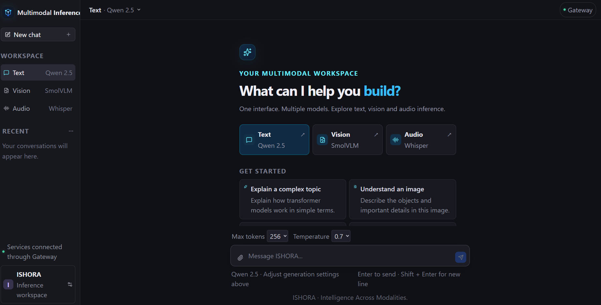

# ISHORA
### One Platform. Multiple Models. Multimodal Intelligence.



ISHORA is a modular, multi-model AI inference platform that brings different AI capabilities together through a unified interface.

It provides a foundation for running and experimenting with models across text, vision, and audio. Its extensible architecture makes it easier to integrate new models, compare their capabilities, and expand the platform as AI technologies evolve.

##  Key Features

- **Multi-Model Support:** Designed to integrate multiple models within each AI modality.
- **Multimodal Inference:** Work with text, images, and audio through one platform.
- **Unified Interface:** Access different AI capabilities from a single application.
- **Modular Architecture:** Keep model inference services independent and easier to extend.
- **Flexible Integration:** Add or replace models without redesigning the entire application.
- **Containerized Deployment:** Run platform services using Docker Compose.

##  Available Models

ISHORA currently integrates the following models and inference components:

| Modality | Model | Capability |
|---|---|---|
| Text | Qwen2.5-1.5B-Instruct | Text generation and instruction following |
| Vision | SmolVLM-500M-Instruct | Image understanding and visual question answering |
| Audio | Whisper Tiny | Speech recognition and transcription |
| Computer Vision | ResNet50 | Image classification through NVIDIA Triton |

### Built for Multiple Models

ISHORA is not limited to a fixed set of models. Its architecture is designed to support additional models across different modalities.

Potential extensions include:

- Multiple LLMs for reasoning, generation, and question answering.
- Different vision-language models for image understanding.
- Additional speech recognition and audio-processing models.
- Specialized models for domain-specific applications, including medical question answering.

These extensions can be integrated progressively as development continues.

##  Architecture

ISHORA follows a modular microservice-oriented architecture.

```text
                    ┌──────────────────────┐
                    │      User Interface  │
                    │     React + Vite     │
                    └──────────┬───────────┘
                               │
                    ┌──────────▼───────────┐
                    │    FastAPI Gateway   │
                    │  Unified API Layer   │
                    └──────────┬───────────┘
                               │
             ┌─────────────────┼─────────────────┐
             │                 │                 │
      ┌──────▼──────┐   ┌──────▼──────┐   ┌──────▼──────┐
      │ Text Service│   │Vision Service│  │Audio Service│
      └──────┬──────┘   └──────┬──────┘   └──────┬──────┘
             │                 │                 │
      ┌──────▼──────┐   ┌──────▼──────┐   ┌──────▼──────┐
      │  LLM Models │   │  VLM Models │   │Whisper Models│
      └─────────────┘   └─────────────┘   └─────────────┘

                 Additional Model Integrations
                       NVIDIA Triton
```

The API gateway provides a unified entry point, while independent inference services handle model-specific processing.

##  Technology Stack

| Component | Technologies |
|---|---|
| Frontend | React, Vite, Tailwind CSS |
| Backend | Python, FastAPI |
| AI Models | Qwen, SmolVLM, Whisper, ResNet50 |
| Inference | vLLM, PyTorch, NVIDIA Triton |
| Deployment | Docker, Docker Compose |

##  Project Structure

```text
ISHORA/
├── frontend-react/
├── gateway/
├── services/
│   ├── text/
│   ├── vision/
│   └── audio/
├── triton/
├── deploy/
├── tests/
├── docker-compose.yml
├── Dockerfile.gateway
└── README.md
```

##  Getting Started

### Prerequisites

- Docker
- Docker Compose
- NVIDIA GPU and NVIDIA Container Toolkit for the current GPU-backed configuration

### Installation

Clone the repository:

```bash
git clone https://github.com/suman862/FutureMachine-AI-Platform.git

conda create - environment name Python=3.11 -y
```

Start the platform:

```bash
docker compose up --build -d
```

### Access the Platform

| Service | URL |
|---|---|
| Web Interface | http://localhost:7860 |
| API Gateway | http://localhost:8000 |
| API Documentation | http://localhost:8000/docs |

### Health Checks

```bash
curl http://localhost:8000/health/live
curl http://localhost:8000/health/ready
```

##  API Examples

**Text Generation**

```bash
curl -X POST http://localhost:8000/v1/text \
  -H "Content-Type: application/json" \
  -d '{"prompt":"Explain computer vision.","max_new_tokens":128}'
```

**Image Understanding**

```bash
curl -X POST http://localhost:8000/v1/vision \
  -F "file=@image.jpg" \
  -F "prompt=Describe this image."
```

**Audio Transcription**

```bash
curl -X POST http://localhost:8000/v1/audio \
  -F "file=@audio.wav"
```

##  Development Roadmap

ISHORA is an evolving project. Planned improvements include:

- Integrating additional open-source LLMs and vision-language models.
- Supporting more model choices within each modality.
- Adding specialized AI applications, including medical question answering.
- Improving model evaluation and response quality.
- Expanding monitoring, observability, and deployment capabilities.
- Exploring scalable inference and model-serving strategies.

##  Project Vision

The goal of ISHORA is to build a flexible AI platform where different models and modalities work together through one unified system.

Rather than depending on a single model, ISHORA aims to provide an extensible foundation for integrating, testing, and serving a growing ecosystem of AI models.

---

**ISHORA — One Platform. Multiple Models. Multimodal Intelligence.**